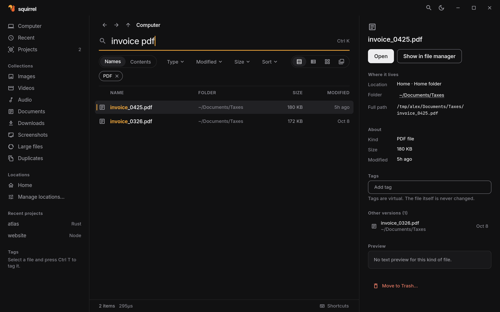
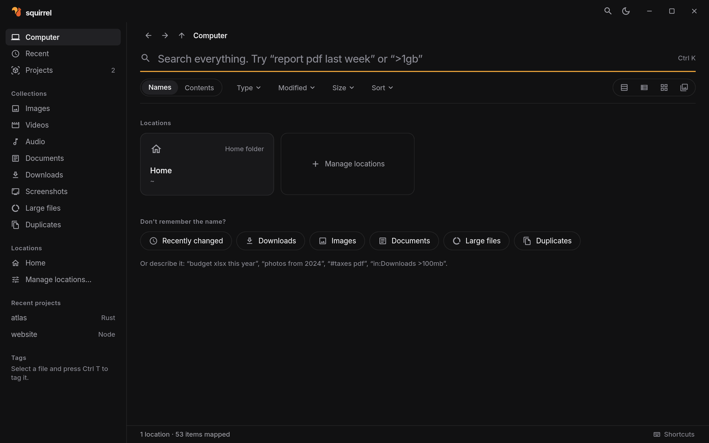
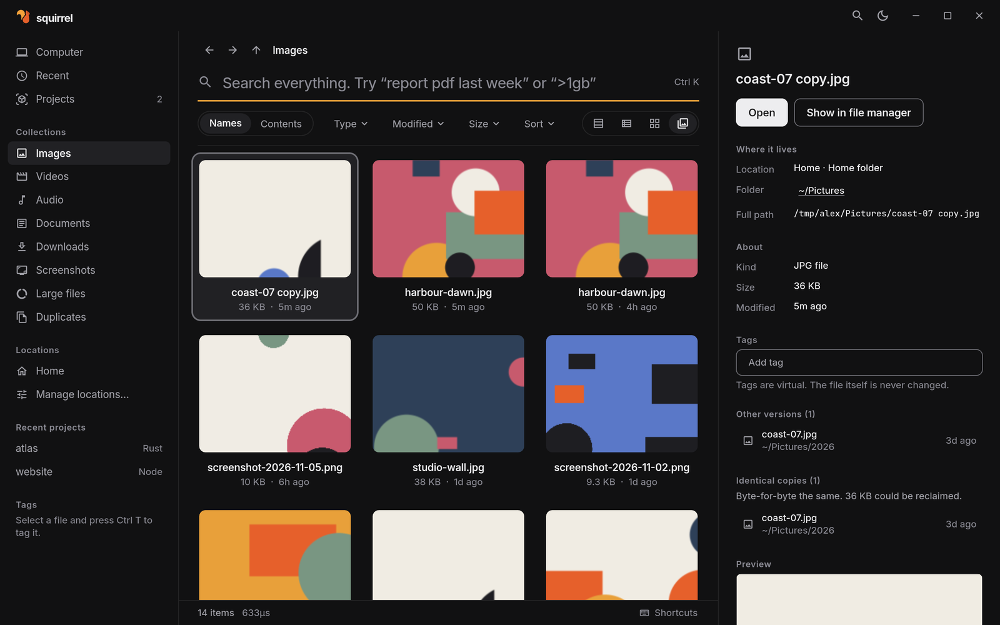
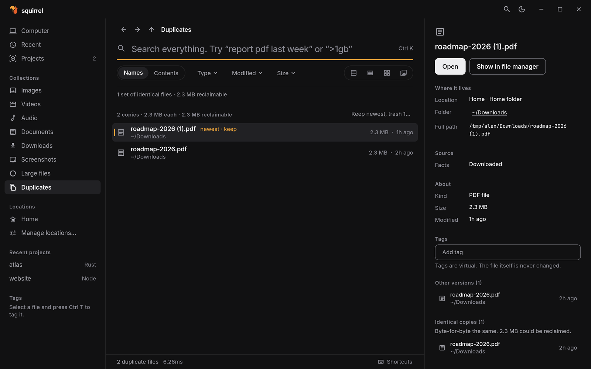
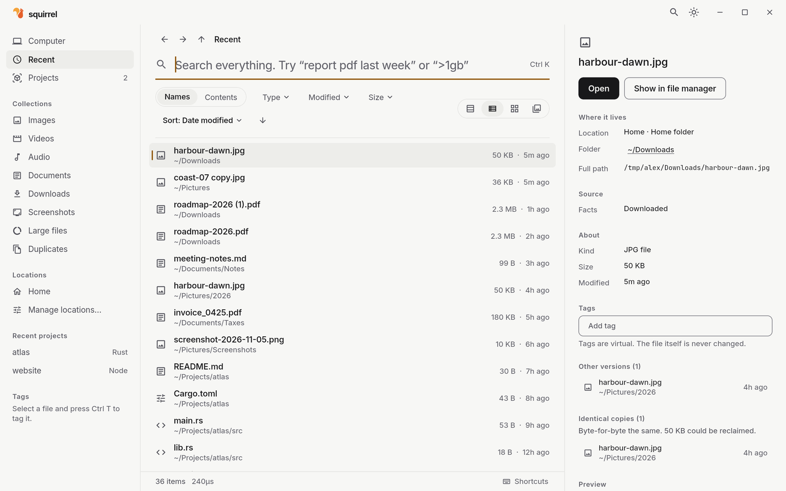

# Squirrel

**Find anything. Move nothing.**

A file manager for your whole computer that organizes everything virtually. 
Search, tag and sort files across every drive without moving a single one.

## Contents

- [The problem](#the-problem)
- [What makes Squirrel different](#what-makes-squirrel-different)
- [Features](#features)
- [Screenshots](#screenshots)
- [Search examples](#search-examples)
- [Performance](#performance)
- [Safety](#safety)
- [Status and availability](#status-and-availability)
- [License](#license)

## The problem

Files end up everywhere: Downloads, project folders, old drives, three copies of the same PDF. Regular file managers show one folder at a time. Search tools find names but cannot organize. Organizing usually means moving and renaming files, which breaks projects, links and backups.

## What makes Squirrel different

| | |
|---|---|
| **Virtual** | Tags, collections, versions and duplicates live in Squirrel's own index. Your folders stay exactly as they are. |
| **Safe** | Nothing on disk changes unless you ask. Creating a file never overwrites, and deleting always goes to the system Trash. |
| **Fast** | Over a million files searched in about 10 ms on a laptop, as you type. |
| **Whole computer** | Maps your system drive, home folder and external drives together, not one folder at a time. |

## Features

- **Search that understands you.** Type `report pdf last week` or `>1gb` and Squirrel turns it into filters. Partial names work too: `rdme` finds `README.md`.
- **Search inside files.** Find text inside notes, code and other text files.
- **Tags.** Tag any file, then filter with `#taxes`. The file itself is never changed.
- **Collections.** Images, videos, documents, downloads, screenshots and large files, gathered from every drive.
- **Duplicates.** Byte-for-byte identical copies, grouped by how much space you would get back.
- **Versions and source.** See other versions of a file, the project it belongs to, and the web address it was downloaded from when the browser recorded one.
- **Four views.** Details, list, tiles and large tiles with image thumbnails.
- **Keyboard first.** Every action has a shortcut. Press `Ctrl /` to see them all.
- **Accessible.** Light and dark themes that meet WCAG 2.2 AA contrast, screen reader labels on controls and results, and result views tested at 200% text size.

## Screenshots

| | |
|---|---|
|  |  |
| **Computer.** Every mapped drive and folder in one place. | **Large tiles.** Thumbnails for images, from any folder. |
|  |  |
| **Duplicates.** Identical copies, newest marked to keep. | **Recent.** Everything you changed lately, light theme. |

More in [docs/screenshots](docs/screenshots).

## Search examples

| You type | Squirrel finds |
|---|---|
| `invoice pdf` | PDFs with "invoice" in the name |
| `photos from 2024` | Images modified in 2024 |
| `#taxes pdf` | PDFs you tagged "taxes" |
| `in:Downloads >100mb` | Files over 100 MB in any Downloads folder |
| `report pdf last week` | PDFs named "report" changed in the last 7 days |
| `>1gb` | Every file over 1 GB |

## Performance

Measured on a real drive with **1,063,819 files and folders** (AMD Ryzen 5 3450U laptop, 13 GB RAM, NVMe SSD, Fedora 44).

| Task | Time |
|---|---|
| Search "readme" (11,818 matches) | 11 ms |
| Each keystroke while typing | 1 to 15 ms |
| Recent files, newest first | 2.4 ms |
| Sort everything by size | 8.5 ms |
| Open a folder | 0.02 ms |
| App start with the index ready | 0.57 s |
| Map the whole drive | 11.8 s |

Method, raw numbers and known slow cases are in [docs/evidence.md](docs/evidence.md).

## Safety

Squirrel reads your drives. It writes only to its own data folder, unless you explicitly create a file or move one to the Trash, and asks you to confirm first.

This is checked by automated tests, including one that maps a deliberately hostile folder and verifies that every byte, timestamp and permission is unchanged afterwards. Details in [docs/safety.md](docs/safety.md).

## Status and availability

Squirrel is in active development and not yet available for download. It runs on Linux today; macOS and Windows support is written but not yet verified.

This repository holds the public documentation and screenshots. The source code is private.

## License

Proprietary. Copyright © 2026 Subhradeep Sarkar. All rights reserved. See [LICENSE](LICENSE).
